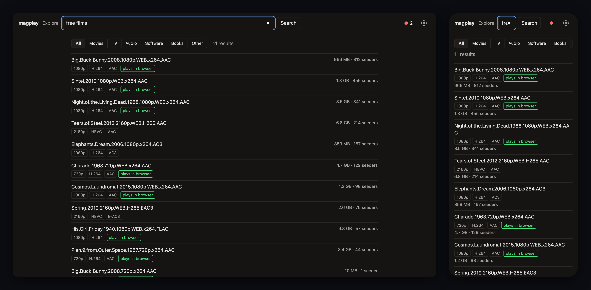
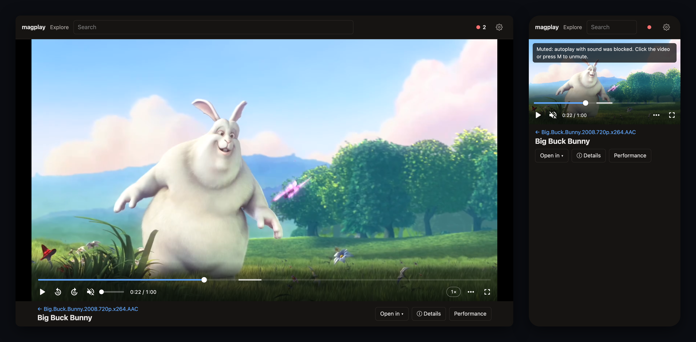
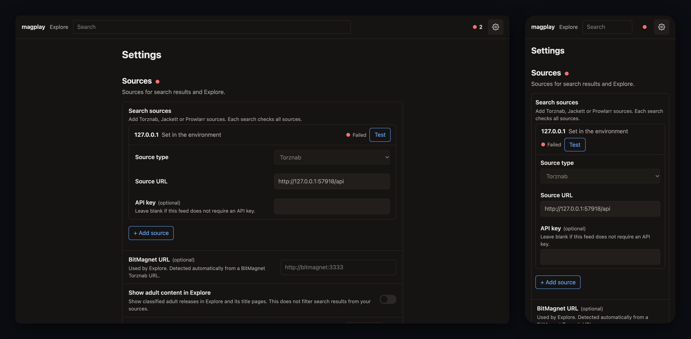
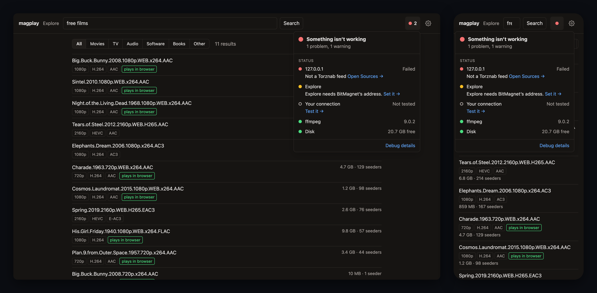

# magplay

Search a Torznab indexer (BitMagnet, Prowlarr…), pick a torrent, and play a video from it, either in the browser or in an external player such as VLC, IINA or Infuse. One small Node.js service, meant for a home server, homelab box or desktop computer on a private network. It has no login.









<sub>The player shows [Big Buck Bunny](https://peach.blender.org/) (© Blender Foundation, CC BY 3.0). To regenerate the screenshots, run `node tools/scripts/screenshots.mjs path/to/big_buck_bunny_720p_h264.mov`.</sub>

For sample media to try it with, Blender’s [Open Movies](https://studio.blender.org/films/) such as Big Buck Bunny and [Elephants Dream](https://orange.blender.org/download/) are shared under Creative Commons.

```
browser ── /api/search ──────────────► sources in parallel: Torznab (BitMagnet, Jackett…), Prowlarr
        ── /api/torrents ────────────► WebTorrent (DHT + trackers) ──► /data/torrents
        ── /raw/:ih/:idx[/name] ─────► torrent file async iterator   (Range requests)
        ── /hls/:session/* ──────────► ffmpeg ◄── reads http://127.0.0.1/raw/:ih/:idx
VLC / IINA / Infuse ── /raw/… ───────┘
```

`/raw` is the single source of bytes. The browser uses it for direct play, ffmpeg and ffprobe read it as their input, and external players open it directly. WebTorrent fetches the pieces under each open stream first, so seeking only downloads what's needed.

See [docs/roadmap.md](docs/roadmap.md) for the current review, verification limits, architecture recommendations and prioritized next steps.

Released changes are listed in [apps/server/CHANGELOG.md](apps/server/CHANGELOG.md), starting with the first release after `0.1.0`. [docs/releases.md](docs/releases.md) explains release notes and how a release is prepared.

## Indexer sources

magplay searches every configured source in parallel, merges the results, and removes duplicates by infohash (keeping the highest seeder count and listing every source a result came from). A source that fails or takes longer than `SEARCH_TIMEOUT_S` doesn't block the rest: you get the other results and a note such as "Jackett timed out after 30 s".

| Source | Env vars | Protocol |
|---|---|---|
| **BitMagnet** | `TORZNAB_URL` | Torznab |
| **Jackett** | `JACKETT_URL`, `JACKETT_APIKEY`, `JACKETT_INDEXER` | Torznab |
| **Prowlarr** | `PROWLARR_URL`, `PROWLARR_APIKEY`, `PROWLARR_INDEXERS` | REST |
| **Any Torznab feed** | `TORZNAB_URL_2` … `TORZNAB_URL_9`, `TORZNAB_APIKEY_n`, `TORZNAB_NAME_n` | Torznab |

Sources can also be added in **Settings**.

- **BitMagnet**: for example `TORZNAB_URL=http://bitmagnet:3333/torznab/api`.
- **Jackett**: for example `JACKETT_URL=http://jackett:9117`. magplay reads the feed at `/api/v2.0/indexers/<JACKETT_INDEXER>/results/torznab/api`. The default indexer `all` searches every configured tracker, and a filter such as `tag:tv,!type:private` also works. A full feed URL in `JACKETT_URL` is used as is.
- **Prowlarr**: for example `PROWLARR_URL=http://prowlarr:9696`. magplay calls `/api/v1/search` across all torrent indexers (`PROWLARR_INDEXERS=-2`, or a list of indexer ids) and sends the key in an `X-Api-Key` header. Prowlarr has no combined Torznab feed.
- **Any Torznab feed**: NZBHydra2, a single Prowlarr indexer at `/<id>/api`, and so on.

Searches always use free-text `t=search` (or `type=search`), never season/episode filters, which hide season packs.

Some results have no magnet or infohash, only a download link through the indexer's proxy (Jackett's `/dl/…`, Prowlarr's `/<id>/download…`). These links contain the indexer's API key in plain text, so they never go to the browser. The page gets an opaque `linkId`, and magplay fetches the link itself when you open the result: either a `.torrent` file or a redirect to a magnet. Ids are kept for the last 5,000 results and are lost on restart ("This search result has expired. Search again."). Prowlarr also rewrites raw magnets into proxy links, so when it reports an infohash magplay builds the magnet itself and skips the proxy.

Each kind of indexer is an adapter in `packages/indexers/src/` implementing the `Source` interface: `search(query, { cat, signal })`, returning normalized releases, and `check()` for the status menu. Adding another kind means writing an adapter with a parse function for its responses, adding its config to the `SourceConfig` union in `sources.ts`, and reading it from env in `apps/server/src/config.ts`.

## Using it

Each page has its own URL, so Back, reload, bookmarks and new tabs all work:

- **Search** (`/?q=…`). Paste a magnet link to look up that torrent directly, without a configured indexer, or enter text to search every source. Magnets support BitTorrent v1 hashes in hexadecimal or base32; their display name appears as one result and trackers and web seeds are retained when opening it. Missing names fall back to the info hash, and malformed or v2-only magnets show a validation error. Text results from every source are merged, with size, seeders, title badges and "plays in browser" for H.264 releases with AAC or unknown audio. With more than one source, chips under the search show each source's result count and each row says where it came from; a failed source is listed with the reason and a **Search again** button. All / Movies / TV / Audio / Software / Books / Other searches again at once. With no search, the page lists **recently opened** torrents from the cache, with the last episode this browser played (✕ hides one in this browser until it's opened again), or a line of help on first run.
- **Explore** (`/explore`, needs BitMagnet). Films and shows from BitMagnet's TMDB-matched index, one tile per title (plain coloured tiles, no posters, nothing loaded from outside). Movies / TV / Music / Audiobooks / Books / Comics / Games / Software / Adult / Uncategorized, Most seeded / Newest, genre chips with counts (left out where BitMagnet only estimated them), year and quality. Each filter change is a history entry, so Back steps back through them. A title page (`/title/…`) shows rating, runtime, genres, overview, IMDb/TMDB links and every release of that exact title in BitMagnet, most seeded first, with **Best release** (the most seeded one that plays in the browser, marked in the list) and **Search all sources**. "Just added" lists the newest releases, including ones BitMagnet couldn't match.
- **Torrent** (`/t/<infohash>`). Opens straight away and counts the seconds while magplay finds peers and the file list (up to `METADATA_TIMEOUT_S`). For torrents with videos, one **Play** button (or **Resume S01E04 at 12:34** where you left off), a **More** menu for the whole torrent (playlist of all episodes, Download all as `.tar`, open or copy the magnet, copy the infohash), and a row per file with ▶ and a ⋯ menu (external players, copy the stream link, download the file). Torrents without video instead have a primary **Download file** or **Download all (.tar)** action, and every file name links to its download. One activity line (peers, speed, how much is on the server) opens into the peer table; each file has a progress bar.
- **Player** (`/play/<infohash>/<file>`). Messages appear on the video. Audio, subtitles, **Open in** (external players) and **ⓘ Details** (mode, codecs, peers, buffer, ffmpeg speed) sit below. A **Next** bar links to the next episode, and at the end of one the next starts after 10 s unless you cancel.

### Playing

During a playback wait, **Torrent → Server → Prepare → Player** shows where work is happening. Select a stage to inspect its measured progress or open **Diagnostics** for the full explanation. A check means ready for playback; downloads or conversion may still be running. **More → Playback flow** pins the view while watching, and **Hide flow** closes it.

Each video can be played these ways:

- **In the browser** (▶). magplay probes the file and picks a mode based on what this browser says it can decode (`MediaSource.isTypeSupported`, not the user agent):
  1. **direct**: MP4/WebM with codecs the browser supports. The browser reads `/raw` itself, and the server does no work.
  2. **remux**: the video codec is supported but the container (MKV…) or the audio (AC3, E-AC3, DTS, TrueHD…) isn't. ffmpeg copies the video into HLS (fMP4) and converts the audio to AAC stereo, which takes very little CPU.
  3. **transcode**: only with `ALLOW_VIDEO_TRANSCODE=true`. libx264 at `TRANSCODE_MAX_HEIGHT`. This is too slow for 1080p on the server CPU.
  4. Otherwise it **refuses** before streaming and explains why (for example HEVC in Firefox).
- **In an external player** (the ⋯ menu, or **Open in** in the player). These links open the same `/raw` URL in a player that decodes everything on the client: HEVC, 10-bit, AV1, DTS, TrueHD and image subtitles (PGS/VobSub), with all audio and subtitle tracks and no ffmpeg on the server. The links offered depend on the device:
  - `.m3u`: works with any player on any OS (the OS opens your default video player). For packs, **More → Play all (.m3u)** puts every episode in one playlist, so the next episode plays automatically.
  - **IINA** (macOS) `iina://weblink?url=…`, **Infuse** (macOS/iOS/tvOS) `infuse://x-callback-url/play?url=…`, **VLC** (iOS/Android) `vlc://…`, **Open with…** (Android) `intent://…#Intent;type=video/*;end`.
  - **Copy stream link** for "Open network stream".

  Links use the address your browser used to reach magplay, plus the file name (`/raw/<ih>/<idx>/Show.S01E01.mkv`), so players show a title. With an external player you lose the in-page status (peers, speed). On a slow torrent the player just buffers; raising VLC's network cache helps.

**Download.** Every file's ⋯ menu has **Download file**, and torrents with several files have **More → Download all (.tar)**, which streams every file as one tar archive. Both go through the same `/raw` path and support Range requests, so an interrupted browser download can resume. Tar needs no extra tools to open on macOS, Linux or Windows 11, and long or non-ASCII file names are kept (PAX headers). **More → Open in your torrent client** hands the magnet to your own client instead. The torrent page shows its infohash (**ID 5d0e004f…**), which copies the full ID when clicked.

**Torrent status.** While a torrent page is open, its activity line (updated every 2 s) opens into the connected peers (address, client, download and upload speed, how much of the torrent each one has; peers not currently sending are greyed out), the total speeds, how much of the torrent is on the server, and a progress bar under each file. It covers downloads and playback alike. A torrent magplay has unloaded after `IDLE_TORRENT_MIN` shows as not active.

Torrents whose title names a program or an archive (`.exe`, `.rar`…) get a neutral download note instead of "plays in browser". Once magplay has opened a torrent and found no video, later searches label it "Download only · no video files". Audio, books, disk images and other non-video files remain downloadable; browser audio-only playback is not implemented.

**Firefox/Zen** can't play HEVC, AC3, E-AC3 or DTS. Audio is converted cheaply, but HEVC is refused, so use an external player or pick an x264 release. **Safari** plays HEVC (remuxed and tagged `hvc1`). **Chrome** plays HEVC where the OS has a decoder.

**ⓘ Details** in the player shows the mode, codecs, peers, how much of the file is on the server, how much is buffered, and ffmpeg's speed (e.g. `85x`). If ffmpeg runs below 1.0x and playback catches up with it, a warning appears on the video. A file the browser can't play gets a card on the video with the first external player for your device, **Copy stream link** and **Back to files**. ffmpeg is paused once it is 4 minutes ahead of playback, so it doesn't fill the disk with segments nobody has watched yet. Seeking past what ffmpeg has produced restarts it at the new position (the seek bar uses the probed duration). Switching the audio track also restarts at the current position. Text subtitles (SRT/ASS/WebVTT inside the file, or `.srt`/`.vtt` files in the torrent) can be selected; image subtitles are listed but disabled.

If autoplay with sound is blocked (Firefox does this on a fresh tab), playback starts muted. Click the video or press **M** to unmute. Other keys: **space** to play/pause, **←/→** to seek 10 s.

## Setup (Docker Compose)

Save this as `compose.yml` and point `TORZNAB_URL` at your indexer:

```yaml
services:
  magplay:
    image: ghcr.io/kasparsd/magplay:edge   # or pin a release version
    restart: unless-stopped
    ports:
      - "3382:8080"
      - "6881:6881/tcp"   # torrent peers
      - "6881:6881/udp"   # DHT
    environment:
      TORZNAB_URL: "http://bitmagnet:3333/torznab/api"
      TORZNAB_NAME: "BitMagnet"
      # Optional, any combination:
      # JACKETT_URL: "http://jackett:9117"
      # JACKETT_APIKEY: "…"
      # PROWLARR_URL: "http://prowlarr:9696"
      # PROWLARR_APIKEY: "…"
      CACHE_MAX_GB: "50"
    volumes:
      - magplay_data:/data
      - /run/avahi-daemon:/run/avahi-daemon:ro   # optional: .local names in source URLs

volumes:
  magplay_data:
```

Start it:

```bash
docker compose up -d
```

Then open `http://example-host:3382/`. To build from a checkout instead of pulling the image, replace `image:` with `build: .`; the repository's own [compose.yml](compose.yml) does this and adds Jackett and Prowlarr (see [Trying it with Jackett and Prowlarr](#trying-it-with-jackett-and-prowlarr)). The image is `node:24-alpine` plus Alpine's `ffmpeg` (about 125 MB to download), builds for `linux/arm64` (and amd64), runs as `node`, and has a healthcheck on `GET /health`.

Prebuilt images are published to `ghcr.io/kasparsd/magplay`. Publishing a GitHub release `vX.Y.Z` tags the image `X.Y.Z`, `X.Y` and `X`; a prerelease (such as `vX.Y.Z-rc.1`) gets only its exact version. Every push to `main` moves the `edge` tag, and older edge builds are deleted. There is no `latest` tag, so pin a release or follow `edge` on purpose.

**Indexer addresses:** inside the container, use Compose service names (`http://bitmagnet:3333/...`, `http://jackett:9117`), IP addresses, or `.local` mDNS names such as `example-host.local`. mDNS multicast doesn't reach a container on Docker's bridge network, so magplay asks the host's avahi-daemon instead: install it on the host (`apt install avahi-daemon`; many Linux systems already run it) and mount its socket directory with `- /run/avahi-daemon:/run/avahi-daemon:ro` under `volumes:`. The log says `Resolving .local names through the host’s avahi-daemon` at startup when the socket is there. Without it, `.local` names fall through to normal DNS, which works in Docker Desktop but usually not on Linux.

**Behind Nginx Proxy Manager:** turn off buffering for streams (Advanced tab: `proxy_buffering off;`). Otherwise nginx buffers `/raw` and `/hls` responses and seeking gets slow. Links in `.m3u` files honour `X-Forwarded-Proto`/`X-Forwarded-Host`.

## VPN

magplay makes torrent connections from the server. An optional [Gluetun deployment](docs/vpn.md) routes its public torrent traffic through a VPN while keeping the web UI accessible locally.

- **BitMagnet on another LAN host:** allow that host as a local outbound exception so indexer requests stay on the LAN.
- **BitMagnet and magplay sharing Gluetun:** use BitMagnet's loopback address; no local outbound exception is needed for those lookups.

The [VPN guide](docs/vpn.md) explains both scenarios, the separate-container Docker-network case, port forwarding and disconnect checks. A standalone [Compose example](tools/docker/compose.vpn.yml) covers the LAN-host scenario.

## HTTP caching and reverse proxies

Successful GETs and HEADs use these policies (HEAD has no body). All errors, including
404-before-ready and 416, use `no-store`; redirects and mutations do too.

| Response class | Cache-Control | Validators / reason |
|---|---|---|
| HTML pages | `no-cache` | Content ETag; store, but revalidate on each use, so a release shows up on reload. |
| `/assets/…` bundles (including `hls.js`), stylesheet and source maps | `public, max-age=31536000, immutable` | Content-hashed file names: a release links new URLs, so any cache may keep these for good. Weak metadata ETag and Last-Modified. |
| Probe API summary | `private, no-cache` | Content ETag; stable media metadata, revalidated for software changes. |
| Raw torrent files and tar downloads | `private, max-age=3600, must-revalidate` | Strong content-identity ETag; one hour of browser reuse, then revalidate. Range/If-Range retained. |
| Completed `/subs/…` conversions | `private, no-cache` | Content ETag; revalidate generated output across releases. |
| Finalized HLS `.m4s` segments | `private, no-cache` | Weak metadata ETag and Last-Modified; atomically published by ffmpeg. Revalidation checks session existence after cleanup. |
| HLS playlists, progressive `.vtt`, startup `init.mp4` | `no-store` | May still be growing; always read origin. |
| Other APIs (search, Explore/title, torrent description, recent, status, health), `.m3u` playlists | `no-store` | Mutable state, expiring link IDs, keepalive side effects or forwarded-host-dependent links. Explore's existing in-process cache is separate from HTTP caching. |

Conditional GET/HEAD supports weak/list/wildcard `If-None-Match`, which takes precedence
over `If-Modified-Since`. A matching validator returns a bodyless 304. Raw/tar
preconditions run before Range; If-Range requires the exact strong ETag (weak or
mismatched validators cause a full response). HEAD ignores Range.
Large files remain streamed: media is not buffered or hashed per request.
`private` intentionally permits browser caching but not shared proxy caches, even
on a single-user server. Cached raw bytes may remain usable for an hour after origin
cache eviction; session media instead always revalidates.

A conservative Nginx configuration needs no disk proxy cache:

```nginx
location / {
    proxy_pass http://magplay:8080;
    proxy_set_header Host $host;
    proxy_set_header X-Forwarded-Host $host;
    proxy_set_header X-Forwarded-Proto $scheme;
    proxy_buffering off;
    proxy_cache off;
    proxy_read_timeout 3600s;
}
```

Respect origin Cache-Control/Expires; do not use `proxy_ignore_headers` or a blanket
`expires`/`immutable` rule. Do not cache POST/DELETE, live endpoints, redirects or
errors (including missing HLS files). Preserve ETag, Last-Modified, conditional
request headers, Range/If-Range, Accept-Ranges, Content-Range and Content-Disposition;
Nginx's default proxy header forwarding does this. Do not buffer media streams.
This example intentionally does not enable shared caching of any API/media.

A caching proxy in front of Node can follow these headers as sent: it must revalidate
the pages (`no-cache`) and may keep `/assets/…` indefinitely. Never give the pages
themselves a fresh TTL, or a release keeps serving old pages that link the previous
release's assets.

Node links the hashed asset names into the pages as it serves them, so let Node
serve the pages. A frontend may serve `dist/client/assets/` itself with
`Cache-Control: public, max-age=31536000, immutable` and proxy everything else to
Node. Deploy the frontend and backend together. No Node/proxy speedup has been
benchmarked.

## Configuration

Open **Settings** from the gear at the right of the top bar (`/settings`). It edits sources, playback and storage limits, saved to `settings.json` in the data folder (`CACHE_DIR`, `./data` by default), and they apply without a restart. The rest of the variables below (ports, cache folder, job limits, timeouts, trackers, ffmpeg paths, DHT and LSD) are set only in the environment. The status button next to the gear shows whether sources, Explore, ffmpeg and the disk are healthy.

Env vars still work and win over saved settings: a field set by one is read-only in Settings and names its variable. magplay never writes `.env`. Sources from env vars are listed first and locked; sources added in Settings follow them.

| Var | Default | Meaning |
|---|---|---|
| `PORT` | `8080` | HTTP port |
| `TORZNAB_URL` | — | Torznab feed. `TORZNAB_URL_2` … `_9` add more feeds. With no indexer env vars set, there are no sources and the server says so at startup. |
| `TORZNAB_APIKEY`, `TORZNAB_NAME` | empty, host name | API key (sent as `apikey=`) and display name; also `_2` … `_9` |
| `JACKETT_URL`, `JACKETT_APIKEY` | — | Jackett base URL and key |
| `JACKETT_INDEXER` | `all` | Jackett indexer id, `all`, or a filter expression |
| `PROWLARR_URL`, `PROWLARR_APIKEY` | — | Prowlarr base URL and key |
| `PROWLARR_INDEXERS` | `-2` | Comma-separated Prowlarr indexer ids; `-2` is every torrent indexer |
| `SEARCH_TIMEOUT_S` | `30` | Per-source search timeout (also Explore's) |
| `BITMAGNET_URL` | from `TORZNAB_URL` | BitMagnet's address, for Explore (its GraphQL API). Found automatically when a Torznab source is at BitMagnet's path `/torznab/api`; without BitMagnet, Explore says so. |
| `LOG_LEVEL` | `info` | Structured stdout/Debug capture level: `debug`, `info`, `warn`, `error`, `silent`; restart required |
| `METRICS_ENABLED` | `false` | Enable the separate private Prometheus listener |
| `METRICS_HOST`, `METRICS_PORT` | `127.0.0.1`, `9091` | Management bind address/port; explicit internal-network bind needed for a container scraper |
| `CACHE_DIR` | `./data` | Torrent data (`torrents/<infohash>/`) and HLS sessions (`hls/`). The Docker image overrides this to `/data`. |
| `CACHE_MAX_GB` | `50` | Least-recently-used torrent folders are deleted above this (checked every minute; torrents in use are kept) |
| `TORRENT_PORT` | `6881` | TCP (peers) and UDP (DHT). Publish both in Compose. |
| `EXTRA_TRACKERS` | opentrackr, stealth.si, torrent.eu.org, explodie.org, desync.com | Comma-separated, added to every torrent (BitMagnet magnets often have none) |
| `METADATA_TIMEOUT_S` | `60` | Give up fetching a torrent's file list after this |
| `IDLE_TORRENT_MIN` | `30` | Unload torrents nobody has streamed or watched for this long (data stays on disk) |
| `ALLOW_VIDEO_TRANSCODE` | `false` | Enable the libx264 path (slow on the server CPU) |
| `TRANSCODE_MAX_HEIGHT` | `720` | Downscale target when transcoding |
| `FFMPEG_PATH`, `FFPROBE_PATH` | `ffmpeg`, `ffprobe` | Paths to the binaries when they aren't on `PATH` |

Local safeguards reject excess jobs with a retryable 503 rather than an unbounded queue. See [resource limits](docs/resources.md), [player lifetime handling](docs/lifecycle.md), and [per-file Resume/Start over behavior](docs/progress.md). HLS disk limits are soft; use a filesystem/container quota for a hard bound.

`TORRENT_CHECK_TIMEOUT_S` (default `7200`) separately bounds cached-piece verification after metadata arrives. `DHT_ENABLED=false` and `LSD_ENABLED=false` disable those discovery mechanisms when using explicit trackers/peers; both default to enabled. See [loopback integration coverage](tests/integration/README.md) and [Docker/server acceptance](docs/deployment-acceptance.md).

Logs are structured JSON on stdout and in Settings → Debug, with linked request/playback/job IDs and secrets removed. The Debug filter changes display only; `LOG_LEVEL` controls capture. The bundled Compose service rotates local logs and uses bounded non-blocking delivery. Inspect with `docker compose logs --since 10m --no-log-prefix magplay`. Metrics are disabled by default and are never served on the browser port. See [logging and observability](docs/logging.md) for the metrics/scrape setup, limits and collection contract.

### Optional local observability stack

For local troubleshooting, the repository Compose file has an opt-in `observability` profile with Prometheus, Loki, Alloy and Grafana. It starts Grafana only on `127.0.0.1:3000`; metrics and backends remain on an internal Docker network. Start it with `docker compose --profile observability up -d --build`, then open `http://127.0.0.1:3000`. The dashboard combines playback/readiness and resource metrics with structured application logs.

Alloy reads the Docker socket to discover this Compose project's magplay container. A read-only Docker socket is still highly privileged, so use this profile only on a trusted development machine; do not mount it on a shared/untrusted server. `docker compose stop grafana alloy loki prometheus` stops just the local backends. Their named volumes retain bounded history; `docker compose down --volumes` removes the whole development stack and its magplay cache. Full operating limits and the isolated-stack validation command are in [logging and observability](docs/logging.md#local-use).

## HTTP API

| Method + path | Does |
|---|---|
| `GET /`, `/t/:ih`, `/play/:ih/:idx` | The pages: search, a torrent's files and activity, the player. Every step has its own URL, so reload, Back, bookmarks and new tabs work. `/t?link=<linkId>` opens a link-only search result and switches to `/t/<infohash>` once resolved. Old `/player.html?ih=&idx=` links redirect. |
| `GET /api/explore?type=&genre=&year=&res=&sort=&page=` | A page of titles from BitMagnet: `{titles:[{type, source, id, title, year, rating, runtime, overview, genres, links, seeders, playable, best}], hasMore}`. `seeders` is the most-seeded release's on that page. `type` is `movie` or `tv_show`, `sort` is `seeders` or `added`. Cached 60 s. |
| `GET /api/explore/facets?type=&genre=&year=&res=` | Genre, year and resolution counts under those filters: `{genres:[{value, label, count, estimate?}], years, resolutions}`. Slow on a big index (tens of seconds for TV), so cached 15 min and warmed for both types at startup. `estimate: true` marks a count BitMagnet only estimated from Postgres statistics (film genre estimates can be 100× too low); Explore shows those without a number. |
| `GET /api/explore/latest?type=` | The newest releases, matched or not |
| `GET /api/title/:type/:source/:id?title=&year=` | A title's metadata and its releases in BitMagnet, from the 100 most-seeded search hits for its name; `truncated: true` when there were more hits |
| `GET /api/recent` | Torrents with saved metadata in the cache, most recently used first: `[{infoHash, name, length, onDisk, lastUsed}]` |
| `GET /api/search?q=&cat=` | Searches all sources. Returns `{results: [{title, infoHash, magnet, linkId, size, seeders\|null, sources, badges, likelyDirect}], sources: [{name, ok, count, error, ms}]}`, with results sorted by seeders, then size. 502 only if every source fails. |
| `POST /api/torrents` `{infoHash \| magnet \| linkId}` | Adds or reuses the torrent, waits for metadata (504 after `METADATA_TIMEOUT_S`) and returns `{infoHash, name, files:[{idx, name, size, isVideo, isSub, season, episode}]}`. Nothing is downloaded until a file is streamed. `linkId` refers to a download link from a recent search (410 if it has expired). |
| `GET /api/torrents/:ih` | The same as `POST /api/torrents` with an infohash: loads the torrent if needed and returns its file list |
| `GET /api/torrents/:ih/status[?idx=&session=&pos=]` | Live view of a loaded torrent (never loads one): `{loaded, activeStreams, downloadSpeed, uploadSpeed, downloaded, length, progress, files:[{idx, progress}], peers:[{address, client, type, downloadSpeed, uploadSpeed, downloaded, uploaded, share, choking}]}`. The player adds `idx` for `file: {progress, ranges}` (which also keeps the torrent loaded) and `session`/`pos` for its ffmpeg session's `{speed, produced, paused, running, failed, error}` (which keeps the session alive). |
| `GET /raw/:ih/:idx[/:name][?download=1]` | The file, with `Range`, `ETag` and `If-Range` support. `download=1` adds `Content-Disposition: attachment`. |
| `GET /tar/:ih[/:name.tar]` | Every file in the torrent as one tar archive (PAX headers), with known length and Range support for resuming |
| `GET /playlist.m3u?ih=[&idx=]` | `.m3u` for external players: one file, or every video in the torrent |
| `GET /api/probe/:ih/:idx` | ffprobe summary: duration, container, video, audio and subtitle tracks, external subtitle files |
| `POST /api/play` `{ih, idx, audio, start, caps, tab}` | `{mode, reason, url, offset, duration, session, subtitles}`, or 422 with an explanation. Stops the tab's previous session. |
| `GET /hls/:session/:file` | Playlist, init segment, segments and `sub_N.vtt` |
| `DELETE` or `POST /api/play/:session` | Stops ffmpeg and deletes the session directory. `POST` is for `navigator.sendBeacon` when the tab closes. Sessions with no requests for 45 s are also stopped. |
| `POST /api/play/tab/:tab` | Closes a page activation, including a session whose POST result has not reached the browser yet; late requests for that activation are fenced briefly. |
| `GET /subs/:ih/:idx/:track.vtt` | Embedded text subtitle `track` as WebVTT (direct mode; reads the whole file), or `file.vtt` to convert a `.srt`/`.vtt`/`.ass` file in the torrent |
| `GET /api/status` | `{level, checks:[{id, label, level, required, value, message, action}]}`. Checks run when asked and are cached (sources and Explore 60 s, disk 30 s, ffmpeg once). |
| `GET /api/settings` | Server settings in use, secrets masked as `{set}`, with `meta[key] = {source: env\|file\|default, env, locked}` |
| `PATCH /api/settings` | A partial update, validated as a whole (400 with `fields` per key, nothing saved) and written atomically. Same-origin only (403 otherwise), like every write below. |
| `POST /api/settings/test` `{key: 'sources', item}` | Checks a source with unsaved values; returns a check result |
| `GET /api/debug` | Version, uptime, ffmpeg versions, busy slots and limits, disk and cache use, and the bounded structured log tail plus capture level/drop count |
| `POST /api/debug/clear-hls` | Stops every conversion and deletes its segments |
| `GET /api/speedtest` | Random bytes (up to 256 MB) for the browser's connection test |
| `GET /health` | 200 `{ ok, uptimeS }`; 503 once shutdown has begun |

## Dependencies

External npm dependencies are declared in their consuming workspace and pinned to exact versions:

| Package | Version | Purpose | Maintainers |
|---|---|---|---|
| [`webtorrent`](https://github.com/webtorrent/webtorrent) | 3.0.21 | Torrent client (DHT, trackers, TCP) | WebTorrent project: Feross Aboukhadijeh, Mathias Buus, Diego Rodríguez Baquero, Alex (alxhotel) and others |
| [`parse-torrent`](https://github.com/webtorrent/parse-torrent) | 11.0.24 | Parse magnets and .torrent files (also used inside webtorrent) | WebTorrent project |
| [`fast-xml-parser`](https://github.com/NaturalIntelligence/fast-xml-parser) | 5.11.2 | Torznab XML | Amit Gupta (NaturalIntelligence) |
| [`hls.js`](https://github.com/video-dev/hls.js) | 1.7.3 | HLS playback in Firefox/Chrome, bundled into the client | video-dev: Rob Walch, Tom Jenkinson, Guillaume du Pontavice |
| `pino` | 10.4.0 | Structured server logging | Pino project |
| `@prometheus-io/client` | 0.16.1 | Metrics registry and collectors | prometheus-io |

Plus `ffmpeg`/`ffprobe` from Alpine Linux.

WebTorrent pulls in about 180 transitive packages, mostly from the WebTorrent project (feross, mafintosh, jhiesey, ThaUnknown…) and common Node utilities. `npm ls --omit=dev --all` lists them all. One is worth knowing about: `node-datachannel` (Murat Doğan) is a native WebRTC module that WebTorrent loads at startup even though magplay doesn't use WebRTC. Its install script downloads a prebuilt binary during `npm ci`, which is why the Dockerfile runs install scripts. uTP is turned off (it would share the DHT's UDP port), so `utp-native` prints a harmless "Cannot find module" warning at startup on Linux.

## Known limits

- **No video transcoding by default.** The ARM CPU can't re-encode 1080p in real time. Use an external player for HEVC/10-bit in Firefox.
- **Seek accuracy in HLS modes:** ffmpeg starts at the keyframe before the requested time, so after a seek the clock can be a few seconds off.
- **Embedded subtitles in direct mode** (rare: MP4 with `mov_text`) require reading the whole file first. In remux mode they come from the same ffmpeg and appear as it goes.
- **Image subtitles** (PGS/VobSub) aren't shown in the browser. Use an external player.
- **Downloads fill the cache:** a download fetches the whole file or torrent into `CACHE_DIR`, and a torrent being downloaded is never evicted, so a torrent bigger than `CACHE_MAX_GB` pushes the cache over the limit until it's done.
- **Each new peer costs one piece:** WebTorrent downloads one random piece from each new peer to validate it, so a few MB arrive even before you play anything.
- **Restarting the container** clears HLS sessions; open players need to start again. Torrent data and metadata are kept, so the file list and cached files reload without peers.
- **Jackett and Prowlarr were tested live with public indexers only** (via the root `compose.yml`). Private trackers with cookies or Cloudflare protection weren't tried.
- **A slow tracker behind Jackett `all` or Prowlarr delays that whole source**, because they wait for all their indexers. magplay cuts the source off at `SEARCH_TIMEOUT_S` and shows the others.
- **Explore relies on BitMagnet's classification.** Releases it didn't match to TMDB have no metadata and only appear in "Just added". The **Show adult content in Explore** setting defaults to off and applies to Explore/title pages only; source search results are not filtered. Adult Explore content is hidden using BitMagnet's own classification (its `xxx` type and TMDB's adult flag), so adult releases BitMagnet didn't recognise can still show in "Just added". Facet counts for TV take tens of seconds the first time; combining several filters can take ~20 s.
- **No auth** by design. Only expose it on a private network (WireGuard).

## Trying it with Jackett and Prowlarr

`compose.yml` in this repo runs magplay together with Jackett (`linuxserver/jackett:v0.24.2663-ls38`) and Prowlarr (`linuxserver/prowlarr:2.6.5.5623-ls162`). It's for local testing.

```bash
echo "BITMAGNET_URL=http://example-host:3333/torznab/api" > .env
```

```bash
docker compose up -d --build
```

```bash
node tools/scripts/setup-indexers.mjs
```

The script adds only the indexers passed on the command line, reads API keys from `tools/docker/*/config/`, writes them to `.env`, and recreates magplay.

Override `MAGPLAY_PORT` and `TORRENT_PORT` in `.env` if those ports are taken. The stack's network is pinned to `10.89.82.0/24` (`DOCKER_SUBNET`): on a machine with many Docker networks, Docker had picked `172.30.0.0/24`, which covered the LAN, so BitMagnet became unreachable from inside the stack.

## Development

```bash
npm install
```

```bash
npm start                 # builds the client, then serves; cache lands in ./data; set TORZNAB_URL etc. to configure an indexer
```

**macOS local-network permission:** if startup succeeds but source requests or Explore count warming fail with `EHOSTUNREACH` (for example, `can't reach bitmagnet.local:3333 (EHOSTUNREACH)`), check **System Settings → Privacy & Security → Local Network**. Enable access for the app hosting your terminal if it is listed (Terminal, iTerm, or your editor for an integrated terminal), then quit and reopen that app and run `npm start` again. Allow local-network access if macOS prompts. See [Apple's local-network permission guide](https://support.apple.com/guide/mac-help/mchla4f49138/mac).

Check connectivity from the same terminal, replacing the example URL with your BitMagnet address:

```bash
node -e 'fetch("http://bitmagnet.local:3333/torznab/api?t=caps", { signal: AbortSignal.timeout(5000) }).then(r => console.log(r.status)).catch(console.error)'
```

`200` confirms an HTTP response from the endpoint; `401` or `403` means it is reachable but requires authentication. If `EHOSTUNREACH` persists after allowing access, check the host address, LAN connection, VPN routing and firewall. This error can have causes other than macOS permissions.

```bash
npm run dev               # rebuilds the client and restarts the server on change
```

```bash
npm run typecheck         # tsc -b over every workspace
npm run lint              # ESLint (neostandard + type-aware rules), no warnings allowed
```

```bash
npm run changeset         # add a release note for your change (see docs/releases.md)
npm run changeset:check -- --base origin/main   # what CI checks on a pull request
```

```bash
npm test                    # Fast Node regression tests
npx playwright install chromium
npm run test:e2e             # Generated local media + real Chromium playback
npm run test:peers           # Real loopback TCP transfer/failure cases
npm run test:all             # Fast + peer + browser suites
```

Playback tests need `ffmpeg` and `ffprobe` on `PATH`, with libx264, AAC and AC3 encoders. They use an isolated temporary torrent cache and a local indexer fixture; no public swarm or running indexer is needed. See [tests/e2e/README.md](tests/e2e/README.md) for coverage, debugging and limitations.

Node 24+, ES modules, npm workspaces. The server and packages use strict TypeScript; the tightening review is complete and remaining client/test/tooling files convert on touch ([plan](docs/plans/package-boundaries-and-typescript.md), [architecture](docs/architecture.md)); the server runs `.ts` packages directly through Node type stripping, with no compile step.

- `apps/server/src/`: the Node service. `main.ts` is the entry point (config, startup checks, graceful shutdown); `app.ts` builds the server from the packages; `config.ts` parses env and saved settings; `services/` coordinates the packages (play, tabs, search, Explore, playlists, subtitles, status); `http/` holds the routes, matched by the `http-kit` router, and the media and error handling.
- `apps/client/src/`: one script per page (`search.js`, `torrent.ts`, `player.ts`, `explore.js`, `title.js`, `settings.ts`), plus `lib/ui.ts` (DOM, formatting, `menu()`, copy buttons, tiles, release rows, per-browser memory), `lib/api.ts` (DOM-independent JSON transport) and `lib/urls.ts` (every URL the pages link to, including the external-player links). esbuild (`npm run build`) bundles each page, including `hls.js`, and the stylesheet into content-hashed `dist/client/assets/`; the server links those hashed URLs into the pages from esbuild's metafile.
- `public/`: HTML and CSS; the server rewrites the pages' script and stylesheet links to the hashed builds.
- `packages/`: `api-contract` (JSON wire types shared by server and client), `release-info` (file kinds, episode numbers, title badges), `indexers` (Torznab, Jackett, Prowlarr and BitMagnet adapters, merged search, download links), `torrent-engine` (the WebTorrent client, torrent cache and eviction), `playback` (ffprobe, the direct/remux/transcode decision, HLS ffmpeg sessions), `seekable-tar` (range-addressable tar streams), `http-kit` (router with typed route params, Range parsing, conditional caching and `serveFile`) and `observability` (structured logs, metrics and runtime collection).

### Test layout

Keep fast tests next to their modules as `*.test.js` or `*.test.ts`, for example `packages/http-kit/src/router.test.ts` and `packages/seekable-tar/src/index.test.ts`. `npm test` builds the client, then discovers these files under `apps/` and `packages/`, plus `tools/scripts/*.test.mjs`, excluding helpers and browser integration tests. Run one file with `node --test apps/client/src/lib/api.test.ts`. Cross-application Playwright tests live in `tests/e2e/*.test.js` and `*.test.ts` and are selected separately by `playwright.config.js`.

Indexer adapters take `fetch` as a parameter and use recorded/synthetic responses in `packages/indexers/src/test-fixtures/`, with shared helpers in `packages/indexers/src/test-helpers.ts`. The fast suite covers source parsing/configuration/errors/timeouts, deduplication, download-link resolution, episodes/badges, tar/ranges, media decisions, session lifecycle, HTTP caching and API-client transport. The Chromium suite exercises cached-torrent playback, seeking, audio switching, subtitles, retries, navigation and media cache policies. [docs/checkpoints/2026-10-17-build-report.md](docs/checkpoints/2026-10-17-build-report.md) retains historical live-swarm and device acceptance checks.

Docker excludes tests, fixture data and helpers from its build context, and the runtime image carries only the server, the packages, `public/` pages and the built client. Node serves only the pages and the content-hashed files in `dist/client/assets/`; client sources and colocated tests are never exposed.

### JSON API client

Import `api` from `apps/client/src/lib/api.ts`. The client keeps same-origin relative URLs, forwards fetch options/AbortSignal/cache settings, preserves caller headers when posting JSON, and never retries implicitly. HTTP errors are `ApiError`s exposing `status` and the server's string error message (or `HTTP <status>` for a non-JSON proxy error). Invalid or empty JSON on a successful response now produces an explicit `Invalid JSON response` error instead of silently returning `{}`. Network, body-stream and abort failures retain their original error/reason. Use ordinary `fetch` for HEAD requests, text subtitles, playlists and media bytes.

`@magplay/api-contract` types probe results, browser capability keys (and holds `CODEC_KEYS`), play requests, direct/HLS decisions, torrent/session status, search results, torrent file lists and Explore responses; the server's handlers are typed against the same interfaces. They are compile-time contracts, not runtime response validation.

### Player helpers

`apps/client/src/player.ts` is the page: its state, playback lifecycle and chrome. The pure parts are in `lib/`: `player-facts.ts` (the ⓘ Details rows), `player-tracks.ts` (audio and subtitle choices and the remembered-language pick), `player-speed.ts`, `player-keys.ts` (the key map) and `format.ts` (byte, speed and clock formatting, without DOM). `apps/client/src/lib/capabilities.ts` measures codec support from explicitly supplied media/browser APIs, without user-agent assumptions or browser globals at import time. `apps/client/src/lib/subtitles.ts` parses ffmpeg WebVTT snapshots, preserving cue text/timing and rejecting invalid timestamps. It is not a complete WebVTT renderer: the page still owns progressive-file handling, subtitle timeline offsets, polling and `VTTCue` creation. These helpers, the `player-*` modules and `lib/progress.ts` have colocated tests. Targeted page/request/timer ownership is implemented without a controller rewrite; further extraction is conditional on an actual maintenance need.

## License

[MIT](LICENSE)
