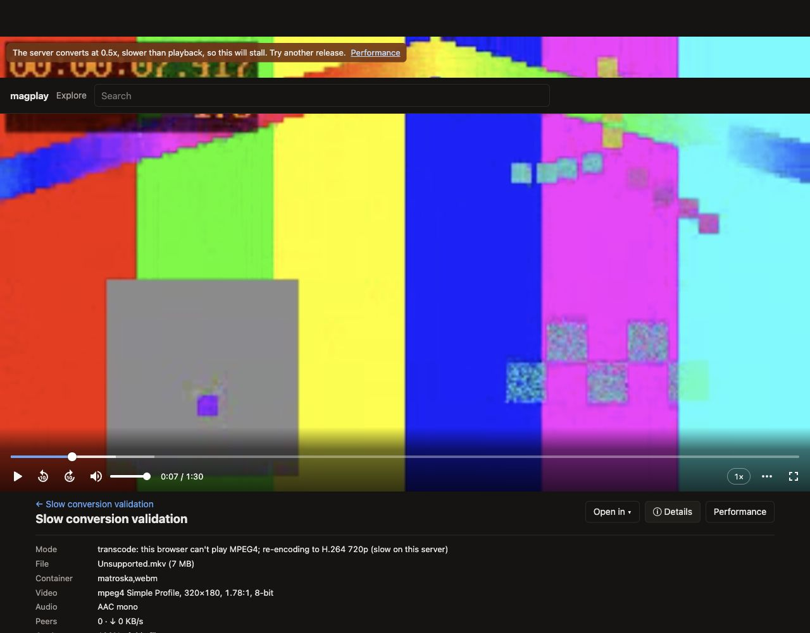

# Cached playback browser validation

Validated on 2026-10-18 using the current checkout and the Codex in-app browser. No application code was changed. The checkout's default `data/` cache contained no torrents, so these checks use generated, private, trackerless torrents with complete content in isolated temporary caches. They do not establish the cause of a particular torrent stalling on another server.

## Observed behavior

| Fully cached input | Policy | Browser result |
| --- | --- | --- |
| H.264/AAC MP4 | Default | Direct playback; clock advanced; Details showed 100% on the server, zero peers, zero download traffic and a substantial buffer. |
| H.264/AC3 MKV | Default | Remux playback; Details showed copied H.264, Matroska repackaging and AC3-to-AAC audio conversion, 100% on the server, 63 seconds buffered and ffmpeg finished at 68.3x. |
| MPEG4/AAC MKV | Video transcoding enabled; deliberately slowed ffmpeg | Long black startup period with zero browser buffer despite 100% on the server; warning appeared as conversion speed dropped below 1x. Later playback reached seven seconds with five seconds buffered and ffmpeg at about 0.5x. |
| Same MPEG4/AAC MKV | Default, video transcoding disabled | Explicit refusal with external-player and alternative-release guidance. |

The slow case used actual ffmpeg H.264 encoding and actual HLS playback, with a temporary ffmpeg wrapper inserting `-readrate 0.5` before the input. This simulates a slow producer; it is not a measurement of this computer's encoding capacity or the user's server CPU. The normal sample is only 320×180 and cannot establish real-time performance for large releases.

## Findings

Being fully downloaded eliminates missing torrent pieces as the source of a wait, but does not eliminate probing, format conversion, HLS segment preparation or browser buffering. An incompatible container or audio codec can require only remuxing and audio conversion; video transcoding is a distinct, opt-in mode.

The UI already exposes mode, decision reason, file availability, buffer and ffmpeg speed under Details, and warns about a running producer below 1x with less than 30 seconds ahead. However, startup and waiting messages share one overlay: `start()` displays a conversion/preparation message, the video `waiting` event replaces it with generic `Buffering…`, and successful `play()` promises clear notifications. Thus the reason is not consistently visible throughout startup. The 45-second first-playlist timeout also blames the torrent being slow even when a fully cached input is being converted slowly. These are code-confirmed explanation gaps; generic buffering replacement and the timeout were not separately forced in this manual run.

The appropriate next UI improvement is persistent stage-aware startup/buffering text combining local-file availability, the actual conversion reason and producer/buffer progress, with external-player guidance when conversion cannot keep up. A specific user's stall still needs their actual playback decision and session diagnostics.
