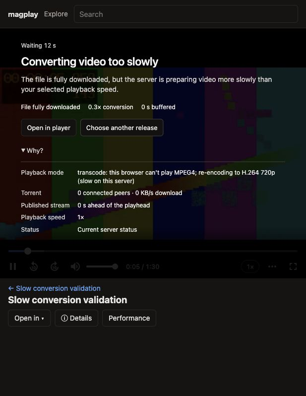

# Playback wait implementation validation

Validated on 2026-10-18 using the working checkout. Canonical behavior lives in [user interface](../user-interface.md#playback-wait-explanations).

## Automated evidence

- `npm test`: 203 unit/integration tests passed, including evidence-based classification, exact completion vs rounded percentages, published segments vs encoder output timestamps, rate-relative capacity, stale status, errors, pause behavior and concurrent preparation cleanup.
- The full Chromium run exercised 47 scenarios; 46 passed initially, and the simulated blocked-autoplay case exposed an ordering issue in the test fixture's click handler. Moving that fixture handler to capture phase enabled the gesture before the player's click action, matching browser behavior. All six buffering-specific browser tests then passed, including that corrected case. Other production browser scenarios passed in the full run, and an earlier targeted playback/chrome run also passed all 30 selected cases.
- The new browser cases use real cached torrents, ffprobe, ffmpeg, HLS and decoding. They hold actual playlist responses to induce a delivery wait, remove an actual session to verify retry ownership, interrupt status polling to verify stale diagnostics, and simulate an autoplay rejection before a real user-gesture recovery. They verify the Why disclosure/focus survives live updates and speed notices, and cover phone-width/fullscreen actions and intentional pause.
- Type checking and repository lint passed. A final focused classification run covers the cache-verification precedence rule added during review.

## Manual browser evidence

Ran the production server against the complete MPEG4/AAC test torrent from the earlier cached-playback investigation, with video transcoding enabled and a temporary ffmpeg wrapper inserting input `-readrate 0.5`, then `0.25`. These rates simulate an insufficient producer; they are not server CPU benchmarks. DHT/LSD and public trackers were disabled.

Observed a centered “Converting video too slowly” explanation with “File fully downloaded,” approximately 0.3x conversion and zero buffered seconds. The expanded Why section showed the real transcode decision, zero connected peers and zero download traffic, zero published seconds ahead, playback speed and status freshness. When frames played again, the blocking explanation changed to a compact capacity advisory. No source download was involved.

The automated layout check exercised a 375×812 viewport and kept the recovery menu inside the fullscreen stage. The manually inspected browser was the Codex in-app browser on this Mac. Public-swarm stalls, remote-server CPU performance and separate Firefox/Safari device acceptance were not rerun for this change; source-wait classification is covered with explicit unit inputs rather than claims of a new live-swarm reproduction.
